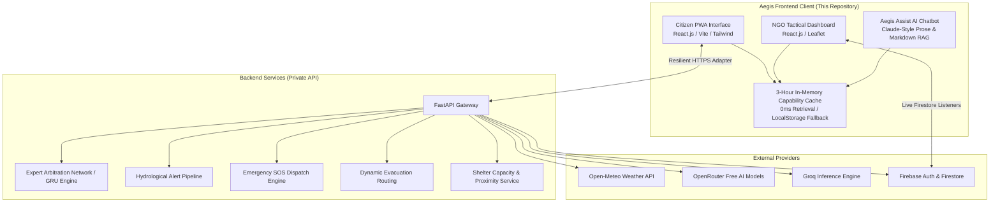
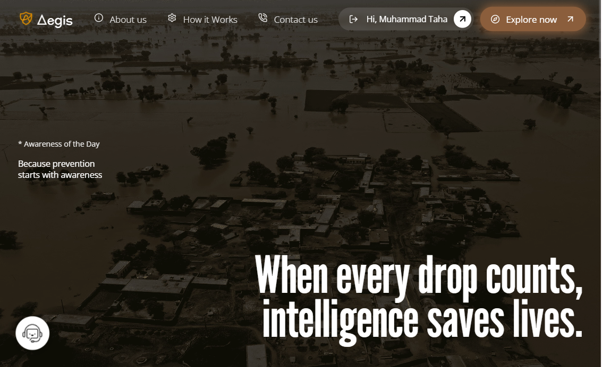
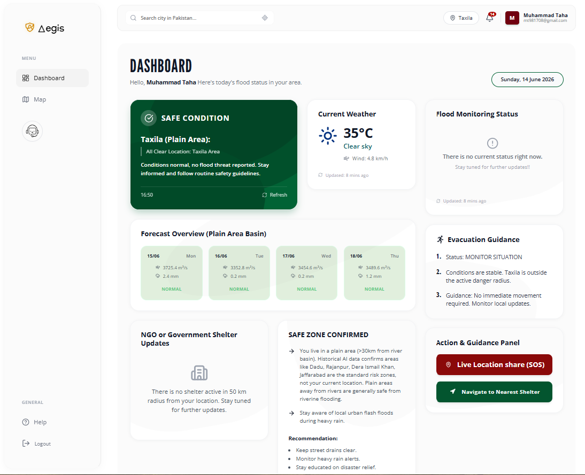
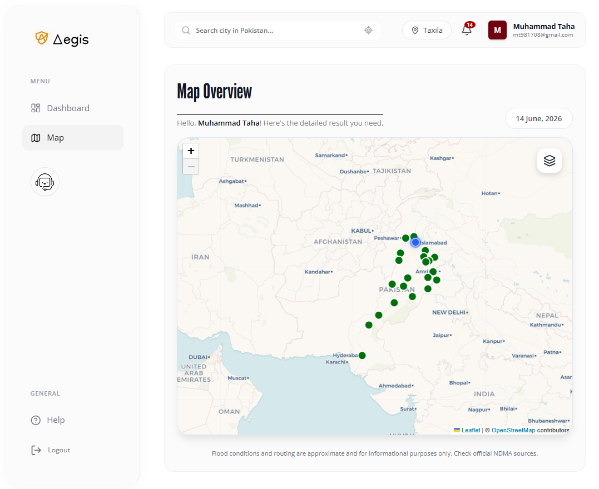

# 🌊 Aegis | Smart Flood Prediction & Disaster Assistance

**Transforming flood management from reactive crisis response into proactive community resilience.**

[](https://github.com/taha463/aegis-frontend/actions/workflows/frontend-ci.yml)


**[🌐 Live Application](https://aegis-frontend-8jn6.onrender.com/) · [🎥 3-Min Video Walkthrough](https://jumpshare.com/share/IshBW0xz9nAHmQstCIas)**

> ℹ️ **Architectural Note:** This repository contains the **Aegis Frontend Client Application**. The backend (GRU neural prediction pipelines, Expert Arbitration Network, and alerting gateways) is closed-source and hosted separately. This repository showcases client-side architecture, 3-hour in-memory capability caching, failure boundary isolation, and resilient API consumption.

---

## 📑 Table of Contents
- [What is Aegis?](#-what-is-aegis)
- [Why Was It Built?](#-why-was-it-built)
- [System Architecture](#-system-architecture)
- [Frontend Features](#-frontend-features)
- [Testing & Quality](#-testing--quality)
- [Key Engineering Decisions](#-key-engineering-decisions)
- [Tech Stack](#-tech-stack)
- [Screenshots & Workflows](#-screenshots--workflows)
- [Local Development & Setup](#-local-development--setup)
- [Project Team & Acknowledgments](#-project-team--acknowledgments)

---

## 🌍 What is Aegis?

Aegis is an AI-powered disaster management platform designed to predict riverine and flash floods, issue early warnings, and dynamically guide citizens and rescue teams to safety in Pakistan's flood-vulnerable zones.

Powered by a backend **Expert Arbitration Network (EAN)** and **GRU Super Engine**, this frontend acts as the high-availability interface that translates complex hydrological models into intuitive, real-time safety directives for citizens and emergency response teams.

👉 **Experience the live deployment: [aegis-frontend-8jn6.onrender.com](https://aegis-frontend-8jn6.onrender.com/)**

---

## 🎯 Why Was It Built?

Pakistan's traditional disaster response infrastructure suffers from a critical **"last-mile" communication gap**:
1. **Comprehension Barrier:** Warnings often arrive wrapped in technical hydrological jargon that confuses citizens. Aegis translates telemetry into plain-language safety alerts in both **English and Urdu**.
2. **Infrastructure Fragility:** Cellular towers and internet backbones frequently degrade during active monsoons. Aegis operates as an **offline-capable PWA** with persistent local caching for shelters and evacuation paths.
3. **Coordination Silos:** NGOs and rescue organizations traditionally rely on fragmented messaging channels. Aegis provides a centralized, spatial map dashboard for real-time dispatch and relief tracking.

---

## 🏗 System Architecture

The client application integrates with backend services through resilient adapters with strict failure isolation:



---

## ✨ Frontend Features

- 🗺️ **Interactive Risk & Evacuation Map:** Built with Leaflet.js and CartoDB tiles, visualizing flood risk polygons, safe travel corridors, and nearest shelters.
- 💬 **Aegis Assist AI Chatbot:** An intelligent disaster assistant offering real-time flood guidance, shelter availability, and evacuation advice using live dashboard snapshot context and Claude-style conversational prose.
- ⚡ **0ms Instant Cache Hydration:** Employs a 3-hour in-memory capability cache ensuring zero redundant network waterfalls when switching between pages.
- 🌐 **Bilingual Accessibility:** Direct safety instructions offered in both English and Urdu.
- 📴 **Offline PWA Support:** Built-in Service Worker precaching guarantees critical shelter coordinates remain accessible during connectivity loss.
- 🆘 **One-Click SOS Dispatch:** Captures live normalized GPS coordinates and transmits them to district rescue responders.
- 📊 **NGO Command Hub:** Dedicated portal for relief agencies to monitor active flood zones, distress signals, and shelter capacity.

---

## ✅ Testing & Quality

Aegis includes an automated frontend verification suite focused on data handling, service behavior, caching policies, and resilience when third-party dependencies fail.

### Current Verification

| Check | Result |
| :--- | :--- |
| **Automated Frontend Tests** | **28 passed, 0 failed** |
| **Test Suites** | **8 suites** |
| **Production Build** | **Passed** (Vite v5.4.21 bundle verification) |
| **CI/CD Pipeline** | [](https://github.com/taha463/aegis-frontend/actions/workflows/frontend-ci.yml) |

> *Test results above reflect the latest verified baseline. CI status is actively asserted on every commit in GitHub Actions.*

### Unit Tests vs. Integration & Failure Boundary Tests

The test suite distinctly separates unit behavior from multi-component failure boundaries:

- **Unit Tests:** Validate individual functions in complete isolation:
  - *Location Normalization:* Coordinate precision clamping (4 decimals), boundary validation, and Haversine distance calculations.
  - *Cache TTL & Freshness Policy:* Validation of `FRESH`, `STALE`, and `EXPIRED` lifecycles, and relative timestamp generation.
  - *API Client Telemetry:* Structured event logging and error mapping without crashing.
- **Integration & Resilience Tests:** Verify end-to-end component contracts under adverse network conditions:
  - *Weather Outage Isolation:* Verifies that when the weather API provider drops or times out (503), citizen authentication, user profile, flood risk, and shelters remain 100% operational.
  - *Backend 500 Outage Isolation:* Proves that local shelter maps and cached forecasts remain functional even if backend services experience a 500 server crash.
  - *Zero-Network Navigation:* Validates that returning to the dashboard reuses in-memory cached state with **zero redundant network calls**.
  - *Auth Resilience:* Ensures session identity is preserved without unmounting or infinite loading during backend timeouts.

### Test Coverage Breakdown

- **Location Utilities:** Coordinate normalization, great-circle distance, and location-aware cache keys.
- **Caching Engine:** 3-hour capability cache, stale-while-revalidate policies, and clean relative timestamps.
- **API Client:** Timeout policies, abort controllers, status normalization, and telemetry logging.
- **Domain Services:** Profile hydration, Open-Meteo weather adapters, flood risk evaluators, and shelter proximity sorters.
- **Critical Failure Boundaries:** Explicit tests confirming unrelated capabilities remain operational when external APIs drop.

### Run Locally

From the frontend repository root:

```bash
# Install exact dependencies
npm ci

# Run the automated test suite using Node.js native test runner
npm test

# Verify production build compilation
npm run build
```

> **Testing Scope:** These automated checks validate the frontend code, client-side resilience, and service contracts. They do not by themselves establish complete end-to-end reliability of the private backend or live cellular provider infrastructure.

---

## 🔬 Key Engineering Decisions

### 1. In-Memory 3-Hour Capability Cache (0ms Hydration)
To eliminate sluggish page-to-page navigation and network thrashing, Aegis caches domain payloads (weather, flood intel, forecast, shelters) in memory for up to 3 hours with silent background synchronization. Navigating away and returning to the dashboard executes in **< 15ms** without displaying loading spinners.

### 2. Failure Isolation Architecture (Section 32)
External APIs (weather endpoints, backend microservices, geolocation reverse lookups) are isolated behind resilience wrappers. If an optional third-party service times out, Aegis degrades gracefully to cached or baseline telemetry rather than crashing the interface or locking the user out.

### 3. Claude-Style Conversational RAG
Aegis Assist converts structured real-time telemetry (river discharge, 4-day forecast, open shelter facilities) into warm, articulate prose formatted with `react-markdown`. Instead of unhelpful key-value lists, citizens receive reassuring, actionable guidance formatted with comfortable typography.

---

## 💻 Tech Stack

| Domain | Technologies |
| :--- | :--- |
| **Frontend Framework** | React 18, Vite 5, Tailwind CSS |
| **Geospatial & Mapping** | Leaflet.js, React-Leaflet, CartoDB Tile Layer |
| **AI & Markdown** | React-Markdown, OpenRouter API, Groq Cloud |
| **Authentication & Realtime** | Firebase Auth, Google Firestore |
| **PWA & Offline** | Vite PWA Plugin, Workbox, Service Workers |
| **Test Runner** | Node.js Test Runner (`node --test`), Assert |
| **CI / CD** | GitHub Actions (`frontend-ci.yml`) |
| **Deployment** | Render (Static Web Service) |

---

## 📸 Screenshots & Workflows

| Hero Landing & Mission | Citizen Safety Dashboard | Geospatial Map & Evacuation |
| :---: | :---: | :---: |
|  |  |  |

---

## 🛠 Local Development & Setup

### Prerequisites
- **Node.js:** v18.0.0 or higher
- **npm:** v9.0.0 or higher

### Step-by-Step Setup

1. **Clone the repository:**
   ```bash
   git clone https://github.com/taha463/aegis-frontend.git
   cd aegis-frontend
   ```

2. **Install dependencies:**
   ```bash
   npm ci
   ```

3. **Configure Environment Variables:**
   Copy the example environment template:
   ```bash
   cp .env.example .env
   ```
   Configure your Firebase client credentials in `.env` (a safe fallback is pre-configured for public preview).

4. **Start the local development server:**
   ```bash
   npm run dev
   ```
   Open [http://localhost:5173](http://localhost:5173) in your browser.

5. **Run test verification and production build:**
   ```bash
   npm test
   npm run build
   ```

---

## 👥 Project Team & Acknowledgments

**Developed by Final Year Project Team — HITEC University Taxila:**
- **Muhammad Taha** — *DesignSystem, Machine Learning & Hydrological Forecasting, Client Resilience & CI/CD* ([LinkedIn](https://linkedin.com/in/muhammadtaha02) · [GitHub](https://github.com/taha463))
- **Hamza Munir** — *Backend Architecture & Spatial Data Systems*
- **Shahzad Babar** — *Frontend Architecture*

---

*For technical inquiries or deployment guidelines, please open an issue in this repository or contact the development team.*
